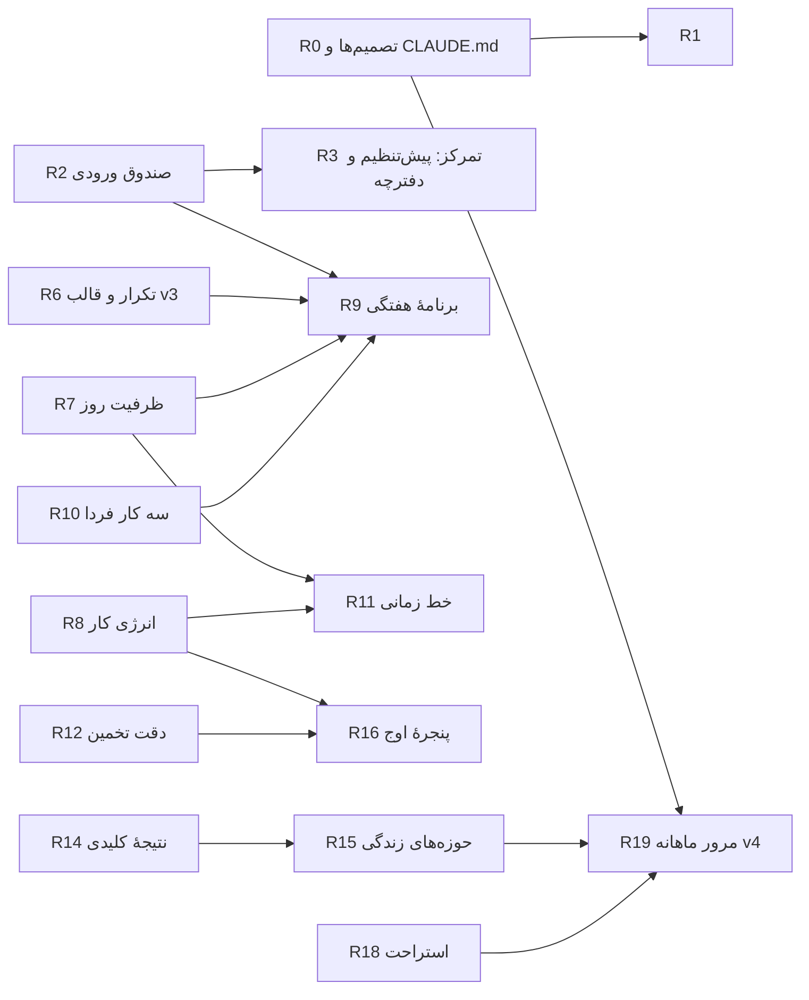

# نقشهٔ راه توسعهٔ اِوالو — فاز ۲ (برنامه‌ریزی و زمان)

> مخاطب این سند: مدل/توسعه‌دهنده‌ای که باید هر قابلیت را **طراحی و پیاده‌سازی** کند.
> پیش از شروع هر کار `CLAUDE.md` و `DESIGN.md` را بخوان. این سند چیزی از آن‌ها را لغو نمی‌کند، مگر در بخش «۱. تصمیم‌های گرفته‌شده» که صریحاً نوشته شده و در نقطه‌عطف R0 به `CLAUDE.md` اعمال می‌شود.
> هر نقطه‌عطف یک جلسه/یک شاخه/یک PR مستقل است. پایان هر کدام: `npm run build` بدون خطا، `npm test` سبز، گزارش کوتاه (تغییرها، فایل‌ها، نتیجهٔ آزمون، پرسش‌های باز) و انتظار برای تأیید.

---

## ۰. وضعیت فعلی اپ (از روی کد، نه حدس)

| حوزه | آنچه هست | فایل‌های کلیدی |
|---|---|---|
| عادت | `cue` (نشانهٔ شروع، متن آزاد)، `minVersion`، `challengeMin`، `difficulty`، `prep`، `obstaclesNote`، `days`، `reminder`، نسخه‌بندی تغییر در `habitRevisions` | `screens/habitLogic.js` (`emptyHabit`, `toHabitRecord`)، `screens/Habits.jsx`، `screens/HabitParts.jsx` |
| کار | `title, date('yyyy-mm-dd'\|'someday'), time, minutes, priority, goalId, done`. **تکرار، انرژی، مهلت و ترتیب ندارد.** سقف ۳ اولویت (`MAX_PRIORITIES` در `data.js`) | `screens/TaskUI.jsx`، `screens/Plan.jsx`، `screens/CalendarViews.jsx` |
| تمرکز | جلسه: `planned, actual, start, taskId, goalId, outcome, energy(25/55/85), note`. پیش‌تنظیم‌ها `[15,25,45,60]` در `Focus.jsx`. تایمر بر پایهٔ `startedAt` در `focusLogic.js` | `focusLogic.js`، `screens/Focus.jsx`، `screens/FocusViews.jsx` |
| هدف | سه نوع (`daily/weekly/milestones`)، زمان و کارهای هر هدف (`goalTime.js`)، معیارهای مهارت (`goalMetrics`) | `goalUtils.js`، `goalTime.js`، `milestoneLogic.js`، `screens/Goals.jsx`، `GoalMetrics.jsx`، `GoalTime.jsx` |
| مرور | روزانه (۳ مرحله) و هفتگی (۵ مرحله)؛ «قدم فردا» می‌تواند کار شود | `screens/Reviews.jsx`، `reflectLogic.js` |
| مربی | قانون‌های عادت (`coachRules.js`) + اعمال با قبل/بعد (`coachApply.js` با `kind: reduce\|habit\|جابه‌جایی کار`). نوع‌های پیشنهاد فعلی فقط عادت و جابه‌جایی کار به `someday` | `coachLogic.js`، `coachRules.js`، `coachApply.js`، `screens/Coach.jsx` |
| بینش | نقشهٔ روزها، روز بهتر هفته، تمرکز×انرژی، دلیل ردکردن | `insightLogic.js`، `screens/Insights.jsx`، `InsightSections.jsx` |
| بازی | XP، ضریب زنجیره، `LEVEL_NAMES`، «بانک» روزهای قدیمی | `gameLogic.js`، `game.js`، `screens/Game.jsx` |
| داده | Dexie نسخهٔ ۲ (`habitRevisions`, `goalMetrics` اضافه شده)، `prune()`، `exportAll()`، `importLogic.js` | `db.js`، `importLogic.js`، `exportLogic.js` |

> **اصلاح نسبت به سند پیشنهادها:** فیلد `cue` از قبل وجود دارد. پیشنهاد «اگر… آنگاه…» پس از این **ارتقا** است، نه ساخت از صفر (R1).

---

## ۱. تصمیم‌های گرفته‌شده (برای دو محدودیتی که در طرح آمده بود)

معیار تصمیم: آنچه به رشد شخصی بلندمدت بیشتر کمک می‌کند و با روح «بدون سرزنش» سازگار است.

### D1 — گیمیفیکیشن: ضریب زنجیره حذف، «مرحلهٔ رشد» می‌ماند (اختیاری)
- **ضریب زنجیره** (`chainMult`، تا ×۱٫۵) حذف می‌شود. پاداش افزایشی برای جلسه‌های پشت‌سرهم روز کم‌کار را ضمناً کم‌ارزش نشان می‌دهد و انگیزهٔ بیرونی را به قیمت کیفیت بالا می‌برد.
- **مراحل رشد** (جوانه تا درخت) می‌مانند به‌شرطی که: هرگز کم نشوند، با دیگران مقایسه نشوند، چیزی از دست نرود، و با کلید `enabled` در تنظیمات قابل‌خاموش‌شدن باشند. واژهٔ «سطح» در UI «مرحلهٔ رشد» شود.
- `CLAUDE.md` بند ۱۱ اصلاح می‌شود (R0).

### D2 — خلاصهٔ ماهانهٔ عددی نگه داشته می‌شود
- ۶۰ روز برای رکورد روزانه می‌ماند. فقط یک **خلاصهٔ عددی کوچک برای هر ماه** (بدون هیچ متن شخصی) در جدول `monthSummaries` برای همیشه می‌ماند، چون دید سه‌ماهه و شش‌ماهه برای رشد شخصی لازم است.
- کاربر می‌تواند در تنظیمات خاموشش کند (`kv.keepMonthly`، پیش‌فرض روشن)؛ خروجی JSON آن را می‌گیرد؛ «حذف همهٔ داده» پاکش می‌کند.
- `CLAUDE.md` بند ۳ اصلاح می‌شود (R0).

### D3 — محدودیت‌های دیگری که تثبیت می‌شوند
- هدف‌های بلندمدت (OKR) نتیجهٔ کلیدی **محاسبه‌ای** فقط تا بازهٔ ۶۰ روز دارند؛ نتیجهٔ طولانی‌تر دستی است (چون زیرداده پاک می‌شود).
- هیچ رگه، امتیاز تنبیهی یا شمارندهٔ «از دست رفته» اضافه نمی‌شود، حتی در آیین‌ها و تکرارها.
- سقف ۳ اولویت در روز در همهٔ مسیرهای جدید (قالب، تکرار، برنامهٔ هفتگی) رعایت می‌شود؛ کار اضافه به «کارهای دیگر» می‌رود.

---

## ۲. قواعد مشترک برای همهٔ نقطه‌عطف‌ها

1. **مهاجرت داده:** هر تغییر شِما = `db.version(n+1)` جدید. نسخه‌های ۱ و ۲ را ویرایش نکن. فیلد غیرایندکس‌شدهٔ جدید روی رکورد موجود نیاز به نسخهٔ جدید ندارد؛ جدول یا ایندکس جدید دارد. برنامه: **v3** در R6 (جدول‌های `recurring`, `dayTemplates` و ایندکس `tasks.recurId`)، **v4** در R19 (`monthSummaries`).
2. **همهٔ مسیرهای داده را به‌روز کن** هر وقت جدول یا کلید `kv` تازه‌ای اضافه می‌شود: `exportAll` (خودکار برای جدول‌ها)، `importLogic.js` (`TABLE_LABELS` و اعتبارسنجی)، `LOCAL_KV` (کلیدهای محلی که وارد نمی‌شوند)، `wipeAll`، `prune()` (فقط برای رکوردهای روزانه)، `exportLogic.js` (CSV)، `reportLogic.js` و `coachExport.js` اگر مرتبط.
3. **منطق جدا از UI:** هر تابع محاسباتی در فایل `*Logic.js` خالص و قابل‌آزمون؛ UI فقط می‌خواند. هر فایل < ۴۰۰ خط (فایل‌های نزدیک به سقف مثل `Reflect.jsx` را تکه کن).
4. **UI:** فقط توکن‌ها و کلاس‌های `styles.css`. بدون ایموجی، بدون رنگ بیرون از پالت. لاوندر فقط برای پیشنهاد مربی. وضعیت‌های پنج‌گانه با شکل. نمایش برای هر ویژگی: خالی، پر، بارگذاری (`Skeleton`)، خطا (متن ملایم)، موفقیت. هر اقدام برگشت‌پذیر `toast` با «بازگردانی» دارد.
5. **زبان:** متن رابط فارسی، دعوت‌کننده؛ هرگز «از دست دادی/عقب افتادی/ناکام». ارقام فارسی با `faNum`.
6. **آزمون:** برای هر منطق جدید آزمون vitest (الگوی `src/tests/db.test.js` با `fake-indexeddb`). برای هر صفحهٔ جدید یک آزمون دودی رندر (الگوی `screens-smoke.test.js`).
7. **دسترسی‌پذیری:** `button/a` واقعی، `aria-label` روی آیکون‌ها، ناحیهٔ لمس ≥ ۴۴px، کنتراست، `prefers-reduced-motion`.
8. **بدون شبکه، بدون کتابخانهٔ جدید.** هر چیزی با React، Dexie و CSS موجود ساخته می‌شود.
9. **شاخه و PR:** برای هر نقطه‌عطف شاخهٔ جدا از `main` با نام `feat/r<N>-<slug>`.

### گراف وابستگی



### ترتیب اجرای پیشنهادی

| فاز | نقطه‌عطف‌ها | هدف |
|---|---|---|
| A · برد سریع | R0, R1, R2, R3, R4, R5 | بدون تغییر بزرگ داده؛ حس روان‌تر شدن |
| B · هستهٔ برنامه‌ریزی | R6, R7, R8, R9, R10 | چرخهٔ کامل: تکرار، ظرفیت، هفته |
| C · دید و بازخورد | R11, R12, R13, R14, R15 | خط زمانی، یادگیری از داده، OKR |
| D · عمق | R16, R17, R18, R19 | انرژی، آیین‌ها، استراحت، ماهانه |

---

## R0 — تصمیم‌ها در قانون اساسی و اصلاح گیمیفیکیشن
**چرا:** تضاد بین `CLAUDE.md` و کد را از بین ببر تا مدل‌های بعدی گیج نشوند.
**کارها**
1. `CLAUDE.md` بند ۱۱: «سطح و نشان‌های بازی‌وار» را به این تغییر بده: «ممنوع: امتیاز تنبیهی، رگه، مقایسه با دیگران، کم‌شدن امتیاز. مجاز و اختیاری: مراحل رشد شخصی که هرگز کم نمی‌شوند.» بند ۳ را با یک بند «خلاصهٔ ماهانهٔ عددی» (D2) کامل کن. بند ۱۲ پرسش ۸ و ۹ برای D1 و D2 اضافه کن با پاسخ «تأیید شد».
2. `gameLogic.js`: `chainMult` و ثابت `CHAIN_MIN` حذف شود؛ `focusXp = START_XP + floor(counted/5)*2` بدون ضریب. `LEVEL_NAMES` بماند.
3. `screens/Game.jsx` و `About/Howto`: واژهٔ «سطح» → «مرحلهٔ رشد»؛ متن توضیح ضریب زنجیره حذف شود.
4. `tests/game.test.js`: آزمون‌های ضریب حذف/به‌روز شوند. آزمون تازه: «XP هرگز با گذشت روز کم نمی‌شود».
**پذیرش:** هیچ ارجاعی به `chainMult` نماند (`grep`)، آزمون‌ها سبز، متن‌ها اصلاح.
**اندازه:** کوچک.

---

## R1 — «اگر… آنگاه…» ساختاریافته برای عادت‌ها (ارتقای `cue`)
**روش:** نیت اجرایی (گولویتزر) + انباشت عادت.
**داده (بدون نسخهٔ جدید Dexie):** فیلدهای اختیاری روی `habit`:
```js
ifThen: { when: 'string', then: 'string' } | null,   // «وقتی …» «آنگاه …»
afterHabitId: number | null                           // لنگر: بعد از عادت X
```
`cue` قدیمی همان `when` در نظر گرفته می‌شود (در `habitToForm`: اگر `ifThen` نبود و `cue` بود، `when = cue`). مهاجرت آنی در خواندن، بدون بازنویسی دیتابیس.
**منطق** (`screens/habitLogic.js` یا فایل تازهٔ `ifThenLogic.js`):
- `ifThenSentence(habit, habitsById)` → «وقتی قهوه‌ام را ریختم، دو دقیقه مطالعه می‌کنم.» یا «بعد از «مسواک شب»، …». اگر لنگر حذف/متوقف شد، فقط `when`.
- `validate`: `then` بدون `when` مجاز نیست (خطای ملایم).
- افزودن `ifThen` و `afterHabitId` به `FIELD_LABELS` تا نسخه‌بندی تغییرات عادت کار کند.
**UI:**
```
┌ فرم عادت › «نشانه و برنامه» ───────────────┐   (راست‌به‌چپ)
│ وقتی … (نشانه)         [ قهوه‌ام را ریختم ] │
│ آنگاه …                [ دو دقیقه مطالعه ] │
│ یا بعد از عادت:        [ انتخاب عادت ▾   ] │
│ ┌ لاوندر: نمونه ───────────────────────┐   │
│ │ «وقتی … آنگاه …» احتمال شروع را بالا  │   │
│ │ می‌برد. نمونه‌ها: [۳ چیپ نمونه]      │   │
│ └──────────────────────────────────────┘   │
└────────────────────────────────────────────┘
```
- جملهٔ ساخته‌شده در `HabitDetail` و زیر عنوان عادت در کارت امروز (متن ۱۳px، `--text2`) دیده شود.
- ۳ چیپ نمونه‌ی ثابت در `examples.js`.
**مربی:** قانون `stronger-cue` در `coachRules.js` در حال حاضر `reminder` پیشنهاد می‌دهد؛ اگر عادت `ifThen` ندارد و ≥۳ ثبت اخیر دارد با ≥۲ نیمه‌کاره/ردشده، پیشنهاد «یک جملهٔ اگر-آنگاه بنویس» (kind `habit`، patch `ifThen`) با قبل/بعد. `ukey: ifthen:<habitId>`.
**آزمون:** جملهٔ خروجی، سازگاری با `cue` قدیمی، حذف لنگر، پیشنهاد مربی و تکراری نشدن ukey.
**پذیرش:** عادت قدیمی بدون خطا باز شود؛ ذخیره/ویرایش/نسخه‌بندی کار کند.
**اندازه:** کوچک (۱–۲ روز).

---

## R2 — صندوق ورودی (ثبت سریع) و مرور آن
**روش:** ثبت سریع GTD.
**داده:** بدون جدول جدید. صندوق = `tasks` با `date: 'someday'` و `inbox: true` (غیرایندکس). پاک‌سازی ۶۰ روزه این‌ها را حذف نمی‌کند (someday).
**منطق** (`planLogic.js` تازه): `addInbox(text)`، `inboxItems(tasks)`، `triage(task, action)` با `action ∈ today|tomorrow|date|someday|delete` (هر کدام تابع بازگردانی برمی‌گرداند).
**UI**
- `AddSheet.jsx`: گزینهٔ اول «فقط بنویس» (یک ورودی، بدون تاریخ) → `addInbox`.
- مسیر جدید `/plan/inbox` (`screens/Inbox.jsx`): یک مورد در هر نما، پنج دکمه؛ پایان: Empty «صندوق خالی است».
- صفحهٔ امروز: چیپ کوچک «صندوق ورودی · ۳» فقط وقتی ≥۱ مورد باشد.
```
┌ صندوق ورودی ───────────── ✕ ┐
│ ۳ مورد مانده                 │
│ ┌──────────────────────────┐ │
│ │ «زنگ به بیمه»            │ │
│ └──────────────────────────┘ │
│ [امروز] [فردا] [یک روز دیگر…]│
│ [روزی] [حذف]       [بعدی ›]  │
└──────────────────────────────┘
```
**آزمون:** افزودن/تریاژ/بازگردانی؛ سقف ۳ اولویت دست‌نخورده؛ آزمون دودی مسیر.
**اندازه:** کوچک.

---

## R3 — تمرکز: پیش‌تنظیم‌های بیشتر، استراحت و دفترچهٔ حواس‌پرتی
**روش:** پومودورو/۵۲-۱۷/کار عمیق.
**داده:** `kv.breakRun` فقط برای تایمر استراحت (محلی؛ به `LOCAL_KV` اضافه شود).
**منطق** (`focusLogic.js`):
```js
export const FOCUS_PRESETS = [
  { key: 'p25', label: '۲۵ و ۵', focus: 25, rest: 5 },
  { key: 'p50', label: '۵۰ و ۱۰', focus: 50, rest: 10 },
  { key: 'p90', label: '۹۰ و ۱۵', focus: 90, rest: 15 },
];
```
تایمر استراحت از همان الگوی `startedAt` (بدون `setInterval` تجمعی). `startBreak(min)`, `breakRemainingMs`.
**UI**
- `Focus.jsx` صفحهٔ آماده‌سازی: سه چیپ پیش‌تنظیم کنار چیپ‌های فعلی؛ انتخاب پیش‌تنظیم `planned` و `restMin` را تنظیم می‌کند.
- پس از ثبت نتیجه (`FocusEnd`): کارت mint «۵ دقیقه استراحت؟» [شروع] [نه، ممنون]. مسیر `/focus/break` ساده با تایمر و دکمهٔ «تمام».
- حین جلسه (`FocusRun`): دکمهٔ آیکونی «چیزی یادم آمد» (`aria-label`) → برگهٔ کوچک با یک ورودی → `addInbox` با `fromFocus: true`. **نباید تایمر را متوقف یا دوباره‌رندر سنگین کند.**
**آزمون:** منطق استراحت؛ ذخیرهٔ حواس‌پرتی بدون تغییر `focusRun`؛ آزمون «بازشدن مجدد اپ تایمر را درست نگه می‌دارد» (موجود) سبز بماند.
**اندازه:** کوچک تا متوسط. **وابسته به R2.**

---

## R4 — یادآور پشتیبان‌گیری
**چرا:** حذف اپ = حذف داده (ریسک ثبت‌شده در CLAUDE.md).
**داده:** `kv.lastExport` (timestamp؛ در هر دو مسیر خروجی JSON/CSV در `PrivacyScreens.jsx` ثبت شود)، `kv.exportNudgeAt`.
**منطق** (`backupLogic.js`): `needsBackupNudge({ lastExport, firstUse, now, nudgeAt })` → اگر `lastExport` نبود و اپ ≥۷ روز استفاده شده، یا آخرین خروجی ≥۱۴ روز پیش، و آخرین نمایش ≥۳ روز پیش.
**UI:** کارت sand در `/today` با «یک نسخهٔ پشتیبان بگیر؛ داده‌هایت فقط روی همین گوشی است» [گرفتن خروجی] [بعداً]. «بعداً» `exportNudgeAt` را به‌روز می‌کند. در `/notifications` تیک اختیاری «یادآور هفتگی پشتیبان» (پیش‌فرض خاموش).
**آزمون:** شرط‌ها در مرزها؛ بعد از خروجی کارت ناپدید شود.
**اندازه:** کوچک.

---

## R5 — صفحهٔ امروز: حالت «ساده»
**مشکل:** کارت‌ها روی هم می‌آیند.
**داده:** `kv.todayMode ∈ 'simple'|'full'`. نبودن مقدار = `full` برای کاربران قبلی؛ `Setup.jsx` برای پروفایل تازه `simple` می‌نویسد.
**UI** (`Today.jsx`، `TodayCards.jsx`):
- سادهٔ پیش‌فرض (ترتیب): تاریخ، `NextAction`، اولویت‌ها، عادت‌های امروز، دکمهٔ «بیشتر ˅». کارت‌های `RecoveryCard` و `HardDay` اگر فعال باشند همیشه دیده شوند (حمایتی‌اند).
- «بیشتر» کارت‌های دیگر (نیت، نقطه‌عطف، بازی، خلاصهٔ هفته، حال، پیشنهاد) را باز می‌کند. وضعیت باز/بسته در همان نشست حفظ می‌شود.
- تعویض در `/prefs` («نمای امروز: ساده / کامل»).
**آزمون:** هر دو حالت رندر؛ `RecoveryCard` در حالت ساده دیده می‌شود.
**اندازه:** کوچک.

---

## R6 — کارهای تکراری و قالب روز  (Dexie v3)
**روش:** روتین/کاهش بار تصمیم.
**شِما:**
```js
db.version(3).stores({
  tasks: '++id,date,recurId',   // ایندکس جدید
  recurring: '++id,status',
  dayTemplates: '++id',
});
```
بدون `upgrade` لازم نیست (فیلد جدید خالی می‌ماند). `recurring` و `dayTemplates` **تعریف** هستند: پاک نمی‌شوند.
**مدل:**
```js
recurring: { title, time, minutes, priority:false, goalId, effort,
  rule: { type: 'daily'|'weekdays'|'weekly'|'monthly', days:[0..6], dom:1..31 },
  startDate, endDate:null, status:'active'|'paused', skip:['yyyy-mm-dd'] }
task.recurId   // کاری که از تکرار ساخته شده
dayTemplate: { title, items:[{ title,time,minutes,priority,effort,goalId }] }
```
**منطق** (`recurLogic.js`، خالص + یک تابع داده):
- `occursOn(rule, dateKey)`: `daily` همیشه؛ `weekdays/weekly` با `weekdayIdx` و `days`؛ `monthly` با روز **شمسی** از `jalali()` و کلمپ برای ماه‌های کوتاه (۳۱ → آخرین روز ماه).
- `generateRecurring(today, horizon=1)` (idempotent): برای هر قاعدهٔ فعال و هر روز `[today … today+horizon]` اگر `occursOn` و `skip` شامل آن نیست و کاری با `{recurId, date}` وجود ندارد، بساز. `priority` ماندن را به `MAX_PRIORITIES` محدود کن.
- هنگام حذف کاری با `recurId` در `TaskSheet.remove`، تاریخ در `skip` قاعده ثبت شود (تا دوباره ساخته نشود). بازگردانی `skip` را برمی‌گرداند.
- اجرا: شروع اپ، بازگشت از پس‌زمینه (همان هوک `prune`)، و باز شدن `/today` و `/plan`.
- `applyTemplate(template, date)` → تابع بازگردانی که تسک‌های ساخته‌شده را حذف می‌کند. `saveDayAsTemplate(date, title)`.
**UI**
- `TaskSheet`: بخش «تکرار» (چیپ: بدون / هر روز / روزهای هفته / هفتگی / ماهانه) و انتخاب روزها. ویرایش یک کار تکراری: پرسش «فقط این بار / همهٔ دفعات».
- `/plan/recurring` (`screens/Recurring.jsx`): فهرست قاعده‌ها با توقف/ویرایش/حذف (حذف با تأیید).
- در `/plan`: دکمهٔ «قالب‌ها» → برگه‌ای با فهرست قالب‌ها (اعمال) و «ذخیرهٔ امروز به‌عنوان قالب».
```
┌ تکرار › کار تازه ──────────────┐
│ تکرار:  (بدون) (هر روز) (هفتگی)│
│ روزها:  ش ی د س چ پ ج          │  ← انتخاب چندتایی
│ از تاریخ: [امروز]  تا: [ندارد] │
│ پیش‌نمایش: «سه‌شنبه و پنجشنبه»  │
└────────────────────────────────┘
```
**آزمون:** `occursOn` برای هر نوع و ماه ۳۱/۳۰/۲۹ روزه، idempotent بودن تولید، `skip` پس از حذف، سقف اولویت، قالب (اعمال + بازگردانی)، `prune` رکورد تعریف را حذف نکند اما تسک‌های ۶۱ روزه را حذف کند، `importLogic` جدول‌های تازه را بپذیرد.
**پذیرش:** کار تکراری هفتگی برای دو هفتهٔ پیاپی درست ساخته شود؛ حذف یک نمونه دوباره ساخته نشود.
**اندازه:** متوسط (۳–۴ روز).

---

## R7 — ظرفیت واقعی روز
**روش:** مغالطهٔ برنامه‌ریزی؛ حاشیهٔ ۲۰٪.
**داده:** `kv.dayPlan`:
```js
{ start:'08:00', end:'22:00', busy:[{ days:[0..6], from:'09:00', to:'17:00', label:'کار' }] }
```
پیش‌فرض: ۰۸:۰۰ تا ۲۲:۰۰ بدون busy (تا کاربر تنظیم کند).
**منطق** (`capacityLogic.js`):
- `capacityMin(dayPlan, dateKey)` = (`end`−`start`) − جمع busy همان روز هفته، سپس × ۰٫۸ (حاشیهٔ اطمینان) و گرد به ۵.
- `plannedMin(tasks)` = جمع `minutes` کارهای انجام‌نشدهٔ آن روز (کار بدون `minutes` شمرده نمی‌شود؛ تعداد آن‌ها جدا برمی‌گردد).
- `loadState(planned, cap)` → `'free'` (≤۷۰٪) `'near'` (۷۰–۱۰۰٪) `'over'` (>۱۰۰٪).
**UI**
- نوار باریک بالای فهرست کارهای امروز و فردا. `free`: «حدود ۱ ساعت و ۴۰ دقیقه جا داری». `near`: «نزدیک ظرفیت امروزی». `over`: کارت sand «این‌ها از ظرفیتی که گفتی بیشتر است. اگر خواستی یکی را به فردا ببریم» [ببر به فردا ‹انتخاب›] — فقط با تأیید. بدون قرمز.
- `/prefs`: «ساعت‌های در دسترس من» (`dayPlan`) با `TimeField`.
```
┌ ظرفیت امروز ─────────────────┐
│ ▓▓▓▓▓▓▓▓▓░░░░░  ۴ س از ۵ س    │  (پر = برنامه‌ریزی‌شده)
│ «نزدیک ظرفیت امروزی است.»    │
└──────────────────────────────┘
```
**مربی:** قانون `lighten-tomorrow` موجود (>۳ کار) را با ظرفیت ترکیب کن: اگر `over`، پیشنهاد جابه‌جایی کم‌اولویت‌ترین (غیر `priority`) به روز بعد؛ kind موجود (انتقال).
**آزمون:** ظرفیت با busy و جمعه/شنبه؛ حالت‌ها در مرز ۷۰٪/۱۰۰٪؛ بدون `minutes`.
**اندازه:** کوچک تا متوسط.

---

## R8 — انرژی کار (سنگین / متوسط / سبک)
**داده (بدون نسخه):** `task.effort ∈ 'heavy'|'medium'|'light'|null`.
**UI:** `TaskSheet` سه چیپ «سنگین / متوسط / سبک» (اختیاری). در `TaskRow` یک نشان کوچک شکل‌دار: سنگین = ۳ خط، متوسط = ۲، سبک = ۱ (SVG خطی؛ نه فقط رنگ). `recurring` و `dayTemplates.items` هم `effort` را حمل می‌کنند.
**منطق:** `EFFORT = [{key,label,weight}]` در `data.js`.
**آزمون:** ذخیره/ویرایش/مهاجرت نرم (رکورد بدون `effort`).
**اندازه:** کوچک.

---

## R9 — برنامه‌ریزی هفتگی  (مرحلهٔ دوم مرور هفتگی)
**روش:** مرور هفتگی GTD + نتیجه‌محوری هفتگی.
**داده:** `kv['weekPlan:'+weekStartKey]`:
```js
{ outcomes:[{ id, title, goalId|null, done:false }], note:'', createdAt }
```
`task.outcomeId` (غیرایندکس) کار را به نتیجه وصل می‌کند. در `prune()` کلیدهای `weekPlan:*` قدیمی‌تر از آستانه پاک شوند.
**منطق** (`weekPlanLogic.js`):
- `suggestOutcomes(goals, weekProgress)`: حداکثر ۳ هدف فعال پیشنهاد (آن‌هایی که این هفته کم‌ثبت‌اند و هدف هفتگی/نقطه‌عطف دارند). فقط چیپ پیشنهاد، نه اعمال.
- `weekLoad(weekStartKey, tasks, dayPlan)` → آرایهٔ ۷ روزه `{date, planned, capacity, state}` (از R7).
- `moveTask(taskId, date)` با بازگردانی؛ جای آزاد = روزهایی که `state === 'free'`.
**UI:** مسیر `/plan/week` (`screens/WeekPlan.jsx`) با ۳ مرحلهٔ قابل‌رد:
```
مرحله ۱ ─ «سه چیز مهم هفتهٔ بعد»
  [ ورودی ... ]  [+]        چیپ‌های پیشنهاد (از اهداف فعال)
  ① ...   ② ...   ③ ...     (سقف ۳)
مرحله ۲ ─ «ظرفیت هفته»
  ش ▓▓▓░░  ی ▓▓▓▓▓ ← کمی پر  د ▓░░░░ ...  (۷ ستون)
مرحله ۳ ─ «کارها را روی روز بگذار»
  فهرست: کارهای مانده + صندوق ورودی
  هر ردیف:  [ش][ی][د][س][چ][پ][ج][روزی]   (یک ضربه)
  جمع بالا: «۴ از ۷ کار جا گرفت»
```
- ورود: پایان `ReviewWeek` یک دکمهٔ «ادامه: برنامهٔ هفتهٔ بعد»؛ همچنین از `/calendar/week`.
- در صفحهٔ امروز کارت کوچک mint «نتیجه‌های این هفته» با تیک (دستی) و پیشرفت از کارهای وصل‌شده.
**آزمون:** `weekLoad` با دادهٔ نمونه، سقف ۳، `moveTask` + بازگردانی، پاکسازی کلید قدیمی، دودی.
**پذیرش:** از پایان مرور هفتگی تا رسیدن به نتیجهٔ ذخیره‌شده بدون بن‌بست؛ رد کردن هر مرحله ممکن.
**اندازه:** متوسط (۴–۵ روز). **وابسته: R2، R6، R7، R10 (اختیاری).**

---

## R10 — «سه کار فردا» (آیوی لی) و «مهم / مهلت‌دار» (آیزنهاور سبک)
**داده (بدون نسخه):** `task.rank` (۱–۳، برای اولویت‌ها)، `task.important` (bool)، `task.deadline` ('yyyy-mm-dd'|null).
**منطق** (`priorityLogic.js`): `pickTomorrow(tasks, ids)` ≤۳ و دادن `rank` به ترتیب؛ `quadrant(task, today)` برای فیلتر: `important && !deadline` («مهم و بدون مهلت»)، `deadline در ≤۳ روز` («نزدیک مهلت»). **ماتریس ۴‌خانه‌ای نمایش داده نمی‌شود.**
**UI**
- `ReviewDay`: مرحلهٔ اختیاری چهارم «سه کار فردا» بعد از «قدم فردا»: فهرست کارهای فردا + مانده‌ها، انتخاب تا ۳ و مرتب‌کردن با دکمه‌های بالا/پایین (نه کشیدن). ذخیره → `priority:true, rank`.
- `TaskList`: اولویت‌ها بر اساس `rank` مرتب.
- `TaskSheet`: سوئیچ «مهم است» و فیلد اختیاری «مهلت».
- در `/plan/inbox` و `/plan`: فیلتر چیپ «مهم و بدون مهلت».
**آزمون:** `pickTomorrow` و سقف، مرتب‌سازی، فیلتر.
**اندازه:** کوچک.

---

## R11 — خط زمانی روز (Time Blocking)
**داده:** بدون تغییر. از `task.time/minutes`، جلسه‌های `focus` (start/actual).
**منطق** (`timelineLogic.js`، خالص):
```js
layoutDay({ tasks, focus, dayPlan, date })
 → { blocks:[{ id, kind:'task'|'focus', start, end, lane, title, done, effort }],
     gaps:[{ start, end, minutes }],       // فقط خالی‌های ≥ ۳۰ دقیقه، داخل بازهٔ dayPlan
     unscheduled:[task] }                  // کارهای بدون ساعت
```
هم‌پوشانی: حداکثر ۲ لِین کنار هم؛ بیشتر از آن به فهرست «تداخل» می‌رود. بدون ساعت → `unscheduled`.
**UI:** `/calendar/day/:d` دو نمای «فهرست / خط زمانی». ارتفاع هر ساعت ثابت (۴۸px)؛ بلوک‌ها با لبهٔ خط‌چین برای «برنامه‌ریزی‌شده» و پر برای «انجام‌شده» (شکل + رنگ). ضربه روی جای خالی → `TaskSheet` با `time` و `minutes` از جا. روی بلوک دکمهٔ «شروع تمرکز» → `/focus` با `taskId`.
```
 ۰۸ ┤
 ۰۹ ┤ ┌ نوشتن گزارش ──┐  ░ جا: ۱ س ۳۰ د   (ضربه = کار تازه)
 ۱۰ ┤ └──── ۹۰ د ──────┘
 ۱۱ ┤ ░░░░░░░░░░░░░░░░░
 ۱۲ ┤ ┌ ناهار ┐
 بدون ساعت: ▢ زنگ به بیمه   ▢ ...
```
**آزمون:** چیدمان با هم‌پوشانی، شکاف‌ها، مرز بازهٔ روز، کار بدون `minutes` (پیش‌فرض ۳۰ دقیقه فقط برای نمایش).
**اندازه:** متوسط تا زیاد (۵–۷ روز؛ بزرگ‌ترین رقم این نقشه). **وابسته: R7، (R8 برای نشان).**

---

## R12 — دقت تخمین (بازخورد برآورد زمان)
**داده:** هیچ؛ از `focus.planned` و `focus.actual`.
**منطق** (`insightLogic.js` یا `estimateLogic.js`):
- `estimateStats(focus)`: جلسه‌هایی با `outcome ∈ done|partial` و `actual ≥ 5`. نیازمند `n ≥ 6`؛ وگرنه `{enough:false, needed}`.
- `ratio = Σactual / Σplanned`، همچنین به‌تفکیک بازه‌های `≤۲۵`، `۲۶–۵۰`، `>۵۰`.
- متن: `ratio > 1.15` «تخمین‌هایت معمولاً کمی کوتاه‌اند؛ میانگین، ۱٫۳ برابر»، `<0.85` «معمولاً زودتر تمام می‌کنی»، وگرنه «برآوردهایت نزدیک واقعیت است». منبع: «از N جلسه».
- **مربی:** قانون `longer-estimate` (kind جدید `task`): کارهای فردا که `minutes` دارند، پیشنهاد `minutes × ratio` گرد‌شده به ۵. `ukey: estimate:<taskId>:<minutes>`. `coachApply.js` باید `kind:'task'` را (الگوی `patchHabit` با بازگردانی) پشتیبانی کند.
**UI:** کارت teal «از داده‌های تو» در `/focus/stats` و `/insights`. بدون قضاوت.
**آزمون:** مرز n=5/6، نسبت‌ها، متن، ukey، اعمال و بازگردانی پیشنهاد.
**اندازه:** کوچک.

---

## R13 — هدف هفتگی انعطاف‌پذیر برای عادت
**داده (بدون نسخه):** `habit.weeklyTarget: 1..6 | null`. وقتی تنظیم باشد `days` برای نمایش «روز ثابت» نادیده گرفته می‌شود.
**منطق** (`habitLogic.js`):
- `habitsForDate`: عادت با `weeklyTarget` هر روز نمایش داده شود تا سهم هفته پر شود.
- `weekCount(habitId, logs, weekStart)` = تعداد `done|partial`. `weekDoneState`: `count ≥ target` → `'complete'` (کم‌رنگ، «این هفته کامل»؛ هنوز قابل‌ثبت).
- هماهنگ‌سازی: قوانین مربی و بینش‌هایی که به `days` تکیه دارند (`coachRules.js`، `insightLogic.js`، `milestoneLogic.js`، `recoveryState`) برای این عادت‌ها نرخ را بر پایهٔ هفته حساب کنند. **ثبت‌نشده = داده نیست؛ هیچ روزی «غایب» حساب نشود.**
**UI:** فرم عادت: انتخاب «روزهای ثابت / تعداد در هفته». نمایش «۲ از ۳ در این هفته» در کارت.
**آزمون:** نمایش روزانه، تکمیل هفته، تغییر هفته (شنبه شروع)، سازگاری قوانین مربی.
**اندازه:** متوسط (۲–۳ روز).

---

## R14 — نتیجهٔ کلیدی برای هدف‌ها (OKR سبک)
**داده (بدون نسخه، داخل سند `goal`):**
```js
goal.keyResults = [{ id, title, unit, start:0, target, current, source:'manual'|'focusMin'|'tasksDone'|'habit',
                     habitId?, period:null|'week'|'month'|'30d'|'60d', doneAt:null }]
```
- منبع محاسبه‌ای فقط با `period` (≤۶۰ روز) مجاز است (D3). منبع دستی برای هر بازه.
**منطق** (`keyResultLogic.js`):
- `krProgress(kr)` = clamp((current−start)/(target−start), 0, 1).
- `krCurrent(kr, rows, today)` برای منابع محاسبه‌ای: `focusMin` از `goalTimeStats` (موجود)، `tasksDone` از کارهای وصل‌شده، `habit` از ثبت‌های `habitId`.
- `goalKrProgress(goal)` میانگین؛ **پیشرفت کلی هدف** در `goalUtils` اگر `keyResults` دارد از همین بیاید (نوع هدف: چهارمی `okr`؛ در فرم هدف انتخاب‌پذیر).
- برچسب‌ها: ≥۷۰٪ «پیشرفت خوب» (سبک OKR: رسیدن به ۷۰٪ هم موفقیت است)؛ هیچ برچسب «ناکام».
**UI:** `GoalDetail`: بخش «نتایج کلیدی» (حداکثر ۳): نوار پیشرفت (لبه‌دار، شکل‌دار)، دکمهٔ «به‌روز کردن عدد» برای دستی، خلاصهٔ منبع («از جلسه‌های تمرکز · ۶۰ روز اخیر»). در پایان دوره (کاربر «پایان دوره» را می‌زند) صفحهٔ آرام «مرور هدف»: چه شد؟ چه یاد گرفتم؟ [ادامه] [بایگانی] [تکمیل]. فایل را از `Goals.jsx` (۳۲۶ خط) جدا کن: `GoalKeyResults.jsx`.
```
┌ نتایج کلیدی ─────────────────────────┐
│ ۱۲ ساعت مطالعه در ۳۰ روز              │
│ ▓▓▓▓▓▓░░░░  ۷ از ۱۲ س · از تمرکز      │
│ ۳ مقاله تمام شود   ▓▓░░░░ ۱ از ۳ (دستی)│
│ [+ نتیجهٔ کلیدی]  (حداکثر ۳)          │
└──────────────────────────────────────┘
```
**آزمون:** پیشرفت، منابع محاسبه‌ای در بازهٔ ۶۰ روز، نپذیرفتن `period` بزرگ‌تر از ۶۰ برای منبع محاسبه‌ای، اعتبارسنجی فرم، سازگاری اهداف قدیمی.
**اندازه:** متوسط تا زیاد (۵–۸ روز).

---

## R15 — توازن حوزه‌های زندگی
**داده (بدون نسخه):** `goal.area` و `habit.area` از فهرست ثابت در `data.js`:
`health` سلامت، `learning` یادگیری، `work` کار، `people` رابطه‌ها، `money` مالی، `self` خودمراقبتی.
**منطق** (`areaLogic.js`): `focusByArea(focus, goals, tasks, range)` (از `sessionGoalId` در `goalTime.js`؛ بدون حوزه = `none`)، `areaShare`. خروجی فقط دقیقه و سهم، بدون «ایده‌آل».
**UI:** فرم هدف/عادت: انتخاب اختیاری حوزه (چیپ). `/insights`: کارت «زمان تمرکز به تفکیک حوزه · ۴ هفته» (نوار انباشته با الگوی شکلی/برچسب‌دار، نه فقط رنگ؛ حتماً جدول متنی معادل برای دسترسی‌پذیری). مرور هفتگی: سؤال اختیاری «کدام حوزه کم‌توجهی ماند؟» (متن آزاد، ذخیره در همان `review`).
**آزمون:** تجمیع، حوزهٔ نامشخص، هدف بدون حوزه.
**اندازه:** متوسط.

---

## R16 — پنجرهٔ اوج انرژی
**روش:** مدیریت انرژی. **وابسته: R8، R12.**
**منطق** (`energyLogic.js`):
- بازه‌های ۲ساعته از `focus.start`. کیفیت هر جلسه `q = outcome(done=1, partial=0.5, skip=0) × (energy/100 اگر موجود، وگرنه ۰٫۷)`.
- پنجرهٔ اوج = بازه‌ای با بیشترین میانگین `q`، شرط: ≥۸ جلسهٔ کل و ≥۲ جلسه در آن بازه و حداقل ۳ بازه داده داشته باشند؛ وگرنه «هنوز داده کافی نیست».
- بینش با `correlation: true` (تذکر «همبستگی است، نه علت»).
**مربی:** قانون `heavy-in-peak` (kind `task`): کارِ `effort:'heavy'` فردا بدون ساعت یا خارج از پنجره → پیشنهاد `time = شروع پنجره`. `ukey: peak:<taskId>:<time>`.
**UI:** کارت teal در `/insights`: «بیشتر جلسه‌های موفقت بین ۹ تا ۱۱ صبح بوده (۱۲ جلسه)». در `TaskSheet` نکتهٔ کوچک وقتی `effort=heavy` و ساعت خارج پنجره است.
**آزمون:** مرزهای داده، تأخیر یک بازه، ukey تکراری نشود، اعمال/بازگردانی.
**اندازه:** متوسط.

---

## R17 — آیین شروع و پایان روز
**داده:** `kv.rituals = { morning:{on,at:'07:30'}, evening:{on,at:'21:00'} }` (پیش‌فرض خاموش). **هیچ ثبت اجرا یا رگه‌ای نگه‌داری نمی‌شود.**
**UI:** مسیرهای `/ritual/morning` و `/ritual/evening` (`screens/Ritual.jsx`) که مراحل را با کامپوننت‌های موجود نشان می‌دهند، همه قابل‌رد:
- صبح: نیت امروز (`Intent`) ← سه اولویت (`/plan`) ← نگاه به خط زمانی/ظرفیت (R7).
- شب: انجام‌شده‌ها (خلاصهٔ امروز) ← مرور روزانه ← سه کار فردا (R10).
- `/notifications`: دو سوئیچ و ساعت. اعلان در `notify.js/buildReminders` اضافه شود با کانال `CH_REMIND`، لحن دعوت‌کننده («اگر دوست داشتی، دو دقیقه برای شبت»)، احترام به ساعت سکوت و سقف روزانه.
**آزمون:** `buildReminders` با آیین‌های روشن/خاموش، سکوت، دودی مسیرها.
**اندازه:** کوچک تا متوسط.

---

## R18 — حالت استراحت و سفر
**داده:** `kv.rest = [{ id, from, to, label? }]` (حداکثر ۶۰ روز هر بازه).
**منطق** (`restLogic.js`): `isRest(date, rest)`.
- `habitsForDate` برای روز استراحت `[]`. اهداف `daily/weekly`: مخرج پیشرفت هفته فقط روزهای غیراستراحت. `capacityMin` (R7) در روز استراحت صفر و نوار پنهان. تولید تکرار (R6) در روز استراحت انجام نشود. اعلان‌ها (`buildReminders`) در بازه ساکت.
- بینش‌ها و نقشهٔ روزها: روز استراحت نشان **جدا** (نماد ماه، رنگ mint با حاشیه) و نه «ثبت‌نشده»؛ از میانگین‌ها بیرون.
**UI:** `/prefs` یا تقویم: «استراحت از … تا …». پایان بازه: کارت mint «خوش برگشتی. اگر خواستی با نسخهٔ حداقلِ یک عادت شروع کن» (از `RecoveryCard`).
**آزمون:** هر مصرف‌کنندهٔ بالا، لبهٔ بازه، همپوشانی، ورودی/خروجی.
**اندازه:** متوسط (چون به چند ماژول وصل است؛ دقت کن).

---

## R19 — مرور ماهانه و خلاصهٔ بلندمدت  (Dexie v4)
**شِما:** `db.version(4).stores({ monthSummaries: 'month' })` — کلید `month` = `'yyyy-mm'` **شمسی** مثل `'1405-07'`. در `DATED_TABLES` **نیست**؛ `prune` آن را لمس نمی‌کند.
**مدل:**
```js
{ month:'1405-07', from:'2026-09-23', to:'2026-10-22', days:30, coverageDays:30,
  focusMin, sessions, tasksDone, habitDone, habitPartial, habitSkipped, habitLoggedDays,
  moodAvg|null, energyAvg|null, reviews, restDays, byArea:{ health:min,… }, createdAt }
```
فقط عدد. بدون عنوان، یادداشت یا متن.
**منطق** (`monthLogic.js`):
- `jalaliMonthRange(ym)` با `jalali()`؛ `buildSummary(rows, range)`؛ `coverageDays` اگر بخشی از ماه پیش‌تر پاک شده باشد (داده ناقص ⇒ `partial:true` و در UI برچسب «بخشی از داده»).
- `rollupMonths(today)` اجرا **پیش از `prune()`** (در همان نقطهٔ شروع/بازگشت): برای هر ماه شمسیِ **تمام‌شده** که خلاصه ندارد و داده‌اش هنوز هست خلاصه می‌سازد. اگر `kv.keepMonthly === false` کاری نمی‌کند. ترتیب در `prune` تضمین شود (رول‌آپ سپس حذف).
**مرور ماهانه** `/review/month` (سه مرحله، قابل‌رد): ۱) چه چیزی کار کرد؟ ۲) چه چیزی سبک‌تر شود؟ ۳) یک تغییر برای ماه بعد. ذخیره به‌صورت `reviews` با `kind:'month'` (متن مثل بقیهٔ مرورها بعد از ۶۰ روز پاک می‌شود؛ فقط خلاصهٔ عددی می‌ماند). بالای صفحه کارت teal «از داده‌های تو» با خلاصه و مقایسه با ماه قبل **به‌صورت توصیف**، نه رتبه.
**بینش:** `InsightSections`: نمودار `Bars` ماهانه (دقیقهٔ تمرکز)؛ ماه بدون خلاصه = ستون نقطه‌چین (ثبت‌نشده).
**تنظیمات/حریم:** سوئیچ «نگه‌داشتن خلاصهٔ ماهانهٔ عددی» در `/privacy` با توضیح ساده. `importLogic`: جدول جدید با اعتبارسنجی کلید؛ `TABLE_LABELS` به‌روز. `wipeAll` همه را می‌برد. `CoachExport` خلاصه را فقط اگر «دسترسی داده‌ها»ی مربوط روشن است بدهد.
**آزمون:** مرز ماه شمسی (۳۱ و ۲۹/۳۰ روزه)، رول‌آپ پیش از prune (رکورد ۶۱ روزه پاک می‌شود ولی خلاصه می‌ماند)، `partial`، `keepMonthly=false`، import/export، idempotent بودن.
**اندازه:** متوسط تا زیاد (۴–۶ روز).

---

## ۳. چک‌لیست نهایی هر PR
- [ ] `npm run build` و `npm test` سبز؛ بدون `console.log` و بدون هشدار جدید.
- [ ] مهاجرت: نسخهٔ جدید Dexie فقط در R6 و R19؛ بررسی باز شدن دیتابیس قدیمی (آزمون با نسخهٔ ۲).
- [ ] `exportAll` / `importLogic` / `wipeAll` / `prune` با جدول یا کلید تازه هماهنگ‌اند.
- [ ] هیچ رنگ بیرون از پالت، هیچ ایموجی، هیچ متن سرزنش‌آمیز.
- [ ] حالت‌های خالی، بارگذاری، خطا، موفقیت و بازگردانی.
- [ ] عرض ۳۶۰/۳۹۰/۴۳۰، فونت بزرگ، کاهش حرکت.
- [ ] هر فایل < ۴۰۰ خط؛ منطق جدا از UI.
- [ ] مسیر ۱ و ۲ (CLAUDE.md بند ۶) هنوز بدون بن‌بست کار می‌کنند.
- [ ] گزارش به کاربر: تغییرها، فایل‌ها، آزمون‌ها، پرسش‌های باز.

## ۴. پرسش‌هایی که بعد از شروع ممکن است پیش بیاید
- کاربر قدیمی با `cue` پر: نمایش جمله با `when = cue` کافی است؛ بازنویسی خودکار داده انجام نشود.
- گوشی‌های قدیمی WebView: ماه شمسی با `Intl` (ریسک ثبت‌شدهٔ CLAUDE.md). اگر آزمون روی اندروید ۹ خطا داد، تابع تبدیل دستی در `util.js` اضافه شود.
- هر جا «داده کافی نیست» لازم است، متن همان «هنوز داده کافی نیست» با توضیح «چند روز دیگر» باشد.

---

## ۵. نمونهٔ پرامپت برای اجرای هر نقطه‌عطف

> `CLAUDE.md`، `DESIGN.md` و `docs/ROADMAP.md` را کامل بخوان. فقط نقطه‌عطف **R<N>** را اجرا کن: شاخهٔ `feat/r<N>-<slug>` از `main` بساز، ابتدا فایل‌های نام‌برده‌شده را بخوان و الگوهای موجود را دنبال کن، منطق را جدا از UI و با آزمون بنویس، `npm run build` و `npm test` را اجرا کن. در پایان گزارش بده: خلاصهٔ تغییرات، فهرست فایل‌ها، نتیجهٔ آزمون و سؤال‌های باز؛ سپس منتظر تأیید بمان. چیزی خارج از R<N> اضافه نکن.
